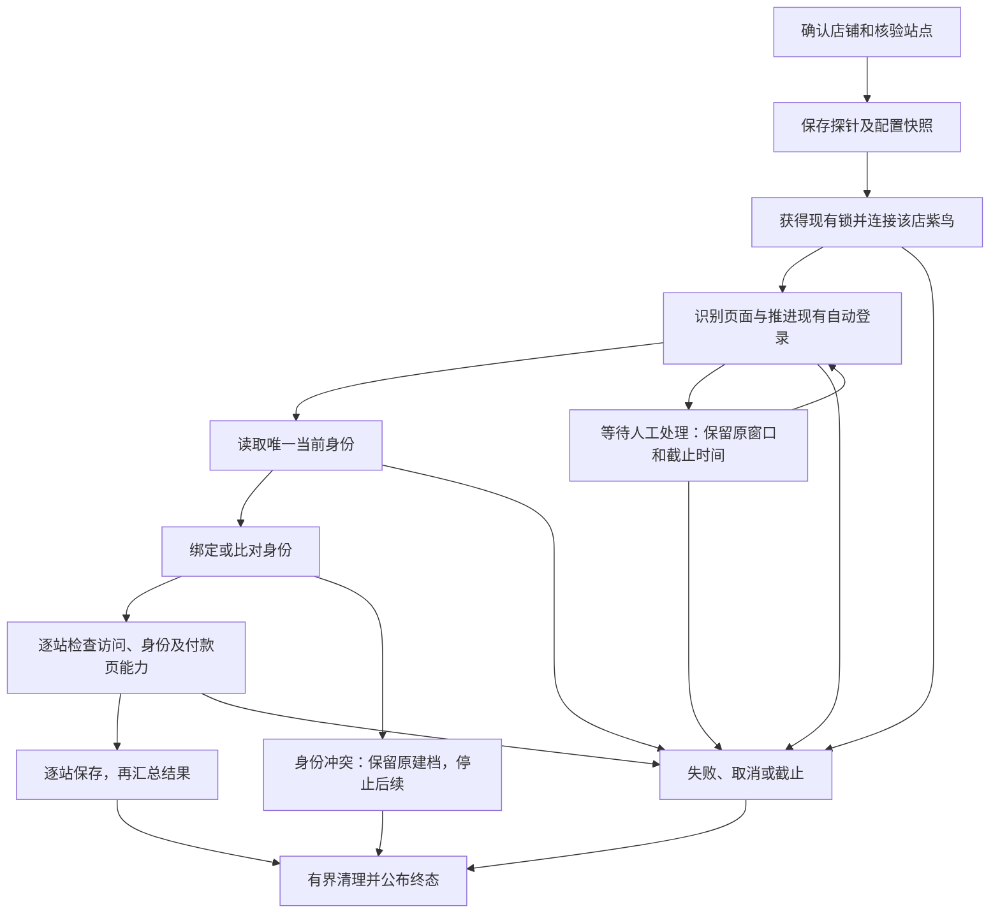

# 店铺建档兼容性修复 Spec

> 实施状态（2026-09-27）：P1—P5代码、自检和紫鸟只读验收记录见 `2026-09-27-store-onboarding-repair-final-verification.md`。源码已完成，正式后台未切换；真实未满足条件及待证据项单列，不代表所有店铺/站点都通过。

- 文档编号：ONBOARDING-REPAIR-20260927
- 日期：2026-09-27；时间展示：Asia/Singapore（UTC+8）。
- 状态：实施中；P1、P2基础层及P2b账号区域/站点状态契约已实现，全量回归及三家紫鸟只读取证已完成；P3/P4/P5待实施，整体尚未验收。实施证据见同目录 `2026-09-27-store-onboarding-repair-progress.md`；本文件仍为需求与验收标准。
- 基线：当前本地工作区，而非旧版本发布包；数据库迁移当前到 0011。
- 适用项目：`D:\Vibe Seller2\ziniao-automation`。
- 实测依据：`data/recon/first-ten-onboarding-live-20260927/建档实测报告.md`、`manifest.json`、`sanitized-runtime-events.json`、`database-verification.json`。
- 工程范围：可重复运行的建档流程，按长期维护型设计；复用现有紫鸟、锁、登录器和清理机制，不新建通用工作流平台，不接入 AI。

## 0. 一句话目标与阅读方式

**让系统清楚区分“资料已经保存”“身份已经核对”“站点可以访问”“付款页面可以识别”，失败说清原因，部分成功可以接着补测。**

✅ **必掌握核心要点**：建档像给每家店填写检查表，不是检查表上填了名字，就代表每一项都检查通过。

⚠️ **高频易错坑**：页面没找到入口，不等于站点未开通；打开了页面，不等于身份正确；没有报错，不等于核验成功。

💡 **思路拓展理解**：本轮建立的是可持续保存的核验记录。后续其他自动化可以读取它作提示，但实际业务执行仍要重新检查现场，不能拿旧建档结果代替实时检查。

正文中的“必须”是验收要求；“待取证”必须先取得真实样本，不能把推测实现成确定规则。

## 1. 实测基线与证据等级

### 1.1 十家实测基线

样本按原报告的 01—10 编号对应，不把真实店名、卖家完整身份或紫鸟环境标识复制到可提交的规格文档。

| 样本 | 实测结果 | 修复验证用途 |
|---|---|---|
| S01、S02 | 当前卖家候选为零；身份失败，站点尚未核验 | 身份页面取证、等待和解析适配 |
| S03、S05 | 身份及 UK 通过；CA/AU 返回 not_offered | 可用站点保持成功，未匹配入口准确分类 |
| S04 | 自动登录停止，进入 WAITING_AUTH，记录后取消 | 保留认证停止原因，继续/取消/超时 |
| S06 | 身份及 CA 通过；UK 结构不符；AU 落到 inactiveAccount 却报 timeout | 解耦付款结构；识别非目标业务页 |
| S07、S08 | 身份及 CA 通过；UK/AU 返回 not_offered | 部分成功、重试范围；S08 的 DE 配置保持 |
| S09 | 身份及 CA/UK 通过；AU 返回 not_offered | 只重试 AU 时不重复核验 CA/UK |
| S10 | 身份及 CA/AU 通过；UK 返回 not_offered | 只重试 UK 时不重复核验 CA/AU |

基线统计：10 家启动紫鸟均首试连接；7 家部分通过、2 家身份失败、1 家等待登录；实际进入站点核验 21 次，其中通过 9、not_offered 10、页面结构错误 1、切换超时 1；另 9 站未进入核验。

### 1.2 已确认与待取证

| 编号 | 问题 | 已确认部分 | 尚未确认部分 |
|---|---|---|---|
| F01 | 身份解析偏窄、等待过早 | 只读取 button 与当前/current 后缀；“没有加载文字”也能结束等待；S01/S02 零候选 | 两家真实页面到底是语言、结构、时序还是其他差异 |
| F02 | 认证原因丢失 | 建档层捕获认证异常后替换为统一说明 | S04 具体是输入未就绪、页面错误、次数耗尽还是其他原因 |
| F03 | 非目标页误判超时 | S06 AU 已进入准确 AU 域名的 inactiveAccount 路径，却返回 timeout | 该页具体要求什么操作；不能仅凭路径断言封号或永久停用 |
| F04 | 建档依赖付款余额 DOM | 核验调用资金 preflight，缺少余额行/无数据标志即失败 | S06 UK 真实布局、权限及账户状态 |
| F05 | not_offered 语义过强 | 精确整串匹配；离线带 current 或待注册后缀都不匹配 | 线上 10 次结果的真实候选文本与注册状态 |
| F06 | 部分成功被批量跳过 | 4 家新建身份都为 PARTIAL，却计入已配置并排除出补全候选 | 无需额外页面证据即可修复 |
| F07 | 提示与行为不符 | “不点击任何按钮”“三种模式均可运行”等文案缺少条件 | 无 |

离线合成 DOM 只证明解析器边界，不能代替 S01/S02/S04/S06 的真实页面证据。验收不要求十家全部显示成功，要求每家结论真实、可解释、可继续处理。

## 2. 本轮范围与不变项

### 2.1 要做

1. 保留结构化认证原因、页面类别和有限脱敏证据。
2. 明确身份候选的就绪条件、来源、唯一性与冲突出口。
3. 对站点候选和跳转落点分类，不把所有异常包装成登录失败或超时。
4. 将只读建档核验与资金 preflight 分开；复用行为相同的读取/校验组件。
5. 保存每次建档和逐站结果；页面刷新及进程重启后仍可查看结果。
6. 提供补齐配置、重试未通过站点、复核所选店铺三种明确操作。
7. 完善取消、截止时间、旧任务回写隔离和清理反馈。
8. 保持原接口路径，新增字段和必要只读/预览接口；回归已有功能。

### 2.2 明确不做

- 不改提现提交、审批、ARMED/回读、防重复、业务队列优先级、排期执行逻辑。
- 不恢复付款账户尾号基线。当前迁移 0005 已移除该基线；建档不以金额、尾号或当日余额作为通过条件。
- 不点击“请求付款”入口或最终付款按钮，不生成 Run、OperationGuard 或付款动作。
- 不新增建档飞书通知；保持本地反馈。
- 不增加登录重试次数，不写第二套自动登录器，不处理未知验证挑战。
- 不在普通 Chrome/其他浏览器打开 Amazon；这些浏览器仅用于本地后台。
- 不把 DE 自动替换成 CA/UK/AU，不增加新的站点支持，也不修改现有 DE/GPSR 功能。
- 不重新加入本地管理员账号密码页面，不改紫鸟/飞书凭据管理。
- 不进行真实提现验收，不打包 exe、不提交或推送 GitHub。

### 2.3 兼容约束

- 保留当前身份绑定的值类型：可能是稳定机器标识，也可能是已核对的准确账号显示名。记录来源，不擅自将所有值解释为 Amazon merchant ID，不做批量转换。
- 已有身份只比对，不在冲突时覆盖；不因某站失败清空身份、关闭店铺、删除勾选站点或修改排期。
- 保留当前新建身份时的启用规则；已有暂停开关按既有语义保持。UI 必须明确显示本次是否发生自动绑定、确认、启用。
- 本轮核验状态用于事实展示和重试选取，不新增 approval/auto 的永久建档门槛；执行任务仍遵守现有实时域名、身份、结构和资金检查。
- 当前统一建档仅支持 CA/UK/AU。DE 可以配置，但显示“本流程不核验”，不标失败、不计入三站通过率。

## 3. 目标流程：每一步都有明确出口

### 3.1 主流程

图中每一步的未画出异常出口同样进入分类错误与最终清理；不存在无限等待的隐含出口。

### 3.2 节点契约

| 节点 | 成功判据 | 非成功出口 | 副作用 |
|---|---|---|---|
| 输入/范围确认 | 店铺存在且属于 Amazon；站点来自明确选择与允许集合 | 422 参数错误；409 状态/范围变化 | 无 |
| 获取资源 | 现有锁到手，连接与配置快照中的同一紫鸟环境 | 启动失败/取消/总截止；不重启整个紫鸟客户端 | 打开目标店环境 |
| 页面分类 | 域名合规；页面可分为登录、选站、业务或特定阻断页 | 未知页面明确记 UNKNOWN_PAGE；错误域名立即停止 | 导航/读取 |
| 认证推进 | 现有登录器确认成功，重新获取当前活页 | 原因可解释的 WAITING_AUTH；取消/截止 | 有界登录动作 |
| 身份读取 | 已加载的当前账号中得到唯一可信身份 | 空候选/多候选/不就绪/未知布局分开记录 | 只读 |
| 身份保存/比对 | 快照仍有效；空绑定写入或与旧值相符 | 身份不符 NEEDS_REVIEW，后续站点 NOT_RUN | 本地事务 |
| 站点访问 | 目标站点及当前身份有独立证据；必要时唯一选站 | 未匹配/待注册/激活页/权限页/未知布局分别记录 | 有界站点切换 |
| 付款能力观察 | 读取已验证的付款页结构类别 | UNKNOWN 不反推身份失败 | 只读；不读金额、不点付款 |
| 保存与汇总 | 每站完成一次原子写入；统计有确定分母 | DB 错误停止后续动作，不返回虚假成功 | 本地事务 |
| 清理 | 原探针拥有的店铺会话关闭/释放被确认 | 清理超时或未确认单独展示，不冒充已释放 | 关闭本探针会话 |

单店普通站点异常允许检查下一站；错误域名、身份冲突、会话关闭/串店等全店不可信异常停止剩余站点。一个店铺正常终结后不阻断批次其他店铺。

## 4. 修复需求

### R01. 认证原因贯穿全链路

- 在现有 `HumanAuthRequired` 上增加可选结构化诊断字段，或通过等价显式结果对象传递；保留现有 `kind`、`dispatch_recorded` 和构造调用兼容。
- `runtime.py` 的身份及站点捕获分支必须保留真实 `reason_code`、登录阶段、最后动作、尝试次数和是否可人工继续。
- 原因由登录器在具体决策点生成；不靠匹配长中文报错推断；没有观测到具体原因就使用 `AUTH_UNKNOWN`。
- 固定原因包括：`AUTH_INPUT_NOT_READY`、`AUTH_RETRY_EXHAUSTED`、`AUTH_PAGE_ERROR`、`AUTH_CHALLENGE`、`AUTH_ACTION_AMBIGUOUS`、`AUTH_UNKNOWN`。
- UI 示例：“等待验证码自动填充超时，尚未提交验证码”，仅在代码确实观察到该事实时显示；不默认显示“次数已用完”。
- 继续按钮沿用当前同窗口恢复与预算规则，不重置全程截止时间，不平白再开一个探针；重复点击不会产生两个执行任务。
- 自动登录正常完成直接推进，无需人工点击继续。只有真实停止时展示人工入口。
- 不记录验证码值、密码、邮箱表单值、Cookie、Token 或认证 URL 查询串。

### R02. 身份读取：先证明已就绪，再解析

- 删除“没有 loading 文案就算加载完成”的单独成功条件。
- 就绪须同时满足：可信账号容器出现、页面不处于已识别加载态、读取到非空候选集，并在连续两次采样中保持一致。
- 超时后区分 `IDENTITY_PAGE_NOT_READY`、`IDENTITY_CURRENT_NOT_FOUND`、`IDENTITY_AMBIGUOUS`、`IDENTITY_LAYOUT_UNKNOWN`。
- 候选提取限定在已验证的“卖家账号区域”；将账号候选与站点候选分开，不能仅凭 class 包含/不包含 account-selected 作唯一依据。
- 适配器使用固定、版本化结构规则；button、role=button、简繁/英文标记可作为待验证适配项，但每项须有真实脱敏样本或明确结构证据才启用。
- 不将“只有一个按钮/只有一个候选”自动当成当前账号。无 current 后缀时，必须有独立 active/selected 语义和账号区域证据；否则保留待核验。
- 多候选不得选第一项；不得把 Canada (current) 当作卖家名称。
- 记录身份来源类型、适配器版本、候选数量与选择依据；卖家实际值按原有本地字段保存，不复制到诊断日志。
- 已有绑定为账号显示名时继续使用原有规范化规则，不擅自删除标点、括号或大小写差异之外的实质内容。
- S01/S02 未取得真实失败页面前，该项只能标记“识别基础设施完成，真实店铺适配待验”，不能宣称两家已经修复。

### R03. 站点候选：地区与状态分开识别

每个候选解析为：站点代码、状态（AVAILABLE/CURRENT/PENDING_REGISTRATION/UNAVAILABLE/UNKNOWN）、来源结构和点击定位证据。

- 保留站点别名白名单与唯一候选要求；仅规范化已验证的当前标记、空白与中英文括号。
- 不粗暴删除所有括号后缀；Pending registration/待注册保持阻断含义。
- 相同站点出现多个候选时返回 `MARKETPLACE_AMBIGUOUS`，不自动选账号。
- 页面已稳定且目标没有合格候选时为 `MARKETPLACE_NOT_OFFERED`，界面写“未匹配到可用入口，开通情况待确认”。
- 列表未就绪时为 `MARKETPLACE_LIST_NOT_READY`；未知候选结构为 `MARKETPLACE_LAYOUT_UNKNOWN`。这些情况不能输出“未开通”。
- 只有明确的页面语义证据才能输出 `REGISTRATION_REQUIRED` 或 `MARKETPLACE_UNAVAILABLE`。
- 点击前重新核对目标文字、候选唯一性、可交互性及遮挡；列表变化重新读，不复用旧索引/坐标。
- 确认后以目标域名、目标站点及页面状态为依据，不以“点击已返回”为成功依据。

### R04. 跳转落点分类

按优先级判断：

1. 错误域名、非预期协议或异常外跳：`DOMAIN_MISMATCH`，停止该店；认证域名仍由现有登录器白名单处理。
2. 已识别的认证页：交还原登录器，不等待付款页面到超时。
3. 目标准确域名的 `/inactiveAccount`：`INACTIVE_ACCOUNT`，解释为“进入账户未激活/状态处理页面”，不声称永久停用。
4. 有明确正文/结构证据的权限页或注册页：`PERMISSION_REQUIRED` / `REGISTRATION_REQUIRED`。
5. 仍在账户/站点选择页：继续有限等待或返回可解释的选站结果。
6. 目标业务页面就绪：核对当前身份/站点后通过。
7. 其他页面：`UNKNOWN_PAGE`；真实达到等待上限才是 `NAVIGATION_TIMEOUT`，附实际页面类别。

域名和路径按结构化 URL 检查，不用字符串 contains；不能因 pathname 正确就忽略 host。不要为了修复 inactiveAccount 扩大资金详情页或提交页的原有允许范围。

共享 `AmazonAccountSwitcher` 当前也用于 GPSR。保留 `SwitchOutcome.ok/reason/offered/landed_url` 的兼容，新增诊断字段有明确默认值；`ok=true` 仍仅表示确认到达调用方指定目标，不能把“识别到阻断页”当成功。GPSR与提现消费端须覆盖新增失败原因，不改变其目标路径契约。

### R05. 解耦建档与资金 preflight

- 新建建档专用只读适配层，例如 `workflows/store_setup/adapter.py`；不在现有 `AmazonPaymentsPage.preflight()` 上增加“跳过身份/结构检查”的开关。
- 可抽出行为一致的页面接管、页面分类和身份读取函数供两者调用；资金 preflight 原检查和失败语义保持。
- 建档分开返回：
  - `identity_check`：当前店铺身份是否一致；
  - `access_check`：目标站点是否可访问；
  - `payment_capability`：SUPPORTED / NO_PAYMENT_DATA / UNKNOWN / NOT_CHECKED。
- 页面缺少余额行，只能影响付款能力识别；若身份和站点确有其他可信证据，可记录访问通过并给能力提示。没有独立证据则保留失败，不能为了提高通过率强行成功。
- 空余额不是失败；官方无付款数据是可识别状态；不读取金额、不进入付款详情页。
- 原 UI 的“自动获取卖家ID并核验站点”和 `/detect-marketplace-setup` 的实际只读分支均使用相同核验语义；保留接口，不恢复历史账户尾号行为。旧 docstring 同步修正。
- 如意外落入付款详情页，仅分类、沿现有允许导航退出/继续识别；不由建档触发付款控件，不扩大通用登录器的详情页接管权限。

### R06. 统一截止、清理与异常终态

- 保留已存在的全程 30 分钟截止；包括排队等锁、连接、自动登录、人工等待、页面操作。人工等待最多取剩余总预算，不能重新获得 30 分钟。
- 页面/协议调用保留有限超时；CDP 清理不能无限等待。清理可使用独立、有限宽限期，但不能继续业务动作。
- 保存 `cleanup_state`：PENDING / CONFIRMED / UNCONFIRMED。状态未确认时展示“流程已停止，窗口释放待确认”，不写“已释放”。
- 清理期间保持活跃生命周期与 FINALIZE 阶段，阻止新探针插入；有界清理结束后才 FINISHED。若最终 UNCONFIRMED，同店新探针和当前批次须返回资源待确认状态，不能仅因部分唯一索引已释放就重新打开环境；经只读资源检查确认释放后才解除阻断。
- 清理失败仅处理本探针拥有的店铺环境，不停止整台紫鸟或其他窗口。全局锁释放不明时暂停批量后续启动并提示检查，不冒险让下一店进入。
- 总截止、页面关闭、取消、普通异常、后台重启均须落明确终态；所有遗留 PENDING/CHECKING 都转换为对应的 NOT_RUN 或中断结果。
- 延迟回调、旧标签页返回、二次取消不得覆盖已落终态。

## 5. 状态与统计契约

### 5.1 不混用三种状态

1. **配置状态**：沿用“待补全 / 已配置”；仅代表身份与站点配置是否齐全。
2. **最近核验状态**：未核验 / 检查中 / 等待验证 / 全部通过 / 部分通过 / 未通过 / 需复核 / 已取消 / 已中断 / 已超时。
3. **付款能力**：每站独立展示已识别 / 无付款数据 / 未识别 / 未检查；不是付款成功、不是实际运行承诺。

任务开关是独立维度。暂停任务的店铺仍可由用户明确发起只读建档。

### 5.2 持久内部状态

- `lifecycle`：QUEUED / CHECKING / WAITING_AUTH / FINISHED。
- `phase`：ACQUIRE_SESSION / AUTHENTICATE / READ_IDENTITY / VERIFY_IDENTITY / CHECK_SITE / FINALIZE / DONE。
- `outcome`：仅终结时填写 SUCCEEDED / PARTIAL / FAILED / NEEDS_REVIEW / CANCELLED / TIMED_OUT / INTERRUPTED。
- 等待验证时保存 `resume_phase`、当前站点、原因和原截止时间；不把它当失败终态。
- 站点 `outcome`：PASSED / BLOCKED / FAILED / NOT_RUN / CANCELLED；另以 `reason_code` 表示原因，未结束时 outcome 为空。
- `attempted` 表示是否真正进入该站点核验；身份阶段顺路访问该域名不算完成站点核验。

### 5.3 汇总规则

- 身份成功，实际请求站点均 PASSED：SUCCEEDED；付款能力 UNKNOWN 仍单独提示，不隐藏。
- 至少一站 PASSED、其余有 BLOCKED/FAILED/NOT_RUN：PARTIAL。
- 身份不可信、无一站通过或基础设施失败：FAILED；身份冲突：NEEDS_REVIEW。
- 用户取消、硬截止、后台重启分别保留专属 outcome，不因已有部分成功改写成成功；已完成站点结果仍保留可见。
- 所有非通过结论都有原因；站点未执行不累计到“测试失败次数”。
- 身份失败的店铺显示“身份未完成，3站未核验”，不显示“3站都失败”。
- 全部站点通过也只叫“建档核验通过”，不叫“提现可成功”或“付款成功”。
- 上述站点汇总针对 unified/marketplace；旧 identity-only 探针只按身份结果终结，不虚构 CA/UK/AU 结果，也不要求额外站点参数。

## 6. 数据持久化、配置变更与恢复

### 6.1 最小数据结构

新增两张表，不把建档伪装成提现 Run，不新建通用批量任务调度器。

**`store_setup_probes`**

- `id` UUID 主键；`store_id` FK；`kind`（unified/identity/marketplace）。
- `request_id` 客户端重试幂等标识；同店同 ID 唯一。
- `request_fingerprint`、`setup_revision`、店铺环境及绑定的本地受限快照。
- `requested_marketplace_codes` 有序快照；`scope`（full/retry_unverified）；`adapter_version`、`policy_version`。
- `lifecycle/phase/outcome`、`identity_result` 受约束 JSON、`reason_code`、安全中文说明。
- `created_at/started_at/deadline_at/updated_at/finished_at`（UTC）；`cleanup_state`；有限脱敏 `diagnostics`。
- 活跃状态对 `store_id` 的部分唯一索引；按 `(store_id, created_at)` 查询历史。

**`store_setup_site_results`**

- `id`、`probe_id` FK、`marketplace_code`；唯一 `(probe_id, marketplace_code)`。
- `attempted`、`outcome`、`identity_check`、`access_check`、`payment_capability`。
- `reason_code`、安全说明、页面类别、准确站点域名、适配器版本、开始/结束时间。
- 本地脱敏证据引用；未取得证据时明确记录 unavailable，不填造占位成功。

**`stores.setup_revision`**：非负递增版本，防止旧结果覆盖新配置。

数据包含真实本地绑定信息的受限快照不直接返回给页面 DTO、不进入日志或导出；对外只返回必要字段。

### 6.2 保存与一致性

- 先提交探针及所有请求站点的初始记录，再打开浏览器；读结果无数据库副作用。
- 每站完成就短事务保存，不等整店结束再保存；等待浏览器时不持有 SQLite 写事务。
- 以 `(probe_id, lifecycle, setup_revision)` 做条件更新；只有活跃且快照匹配的探针可写回当前建档。
- 身份初次自动绑定与探针采用的新 revision 在同一事务更新；本探针后续站点沿用新 revision，不被自己的写入误判成过期。
- 环境、身份/确认状态、站点集合变化或重置建档：revision 递增，旧结果保留作历史但不展示为当前通过；仅重命名/暂停任务不使身份核验过期。
- 有活动探针时保留既有冲突保护：修改身份/环境/站点、重置或删除返回 409，取消并完成清理后再操作；数据库条件更新仍要防并发窗口。
- 新一次仅重试失败站点时，当前摘要从同一 revision、同一适配器有效版本下的每站最新结果合并；不得因本次只测 AU 就丢掉 CA/UK 成功记录。
- 存在较新的失败/中断结果时，不以更早的通过掩盖；可以另显示“上次通过时间”。
- 重置建档沿用既有身份清理和排期停用语义；历史核验记录因 revision 变化不再作为当前结果。
- 同步直接删除店铺的既有行为保留；新核验记录属于该店配置数据，随店铺删除级联清理。现有资金历史和截图保留规则不改。

### 6.3 重启恢复

- 上一次进程遗留活跃探针统一收口为 INTERRUPTED，保留已完成结果；未执行站点 NOT_RUN，正在检查的站点记录中断。
- WAITING_AUTH 不伪装成继续等待仍存在的页面，显示“上次验证现场已中断，请重新核验”。
- 不在启动时自动重开店铺、自动登录或自动重放批量建档。
- 只有能确认归属的旧会话才尝试有界清理；归属或释放不明保留明确提示，不关闭整台紫鸟。
- 用户再发起重试是新探针、新截止时间；仍核对当前身份，不延用旧 Page/CDP 句柄。

## 7. API 与前端

### 7.1 保留的路径

- `POST /api/stores/{store_id}/detect-store-setup`
- `GET /api/stores/{store_id}/store-setup-probe`
- `GET /api/stores/{store_id}/store-setup-probes/{probe_id}`
- `POST /api/stores/{store_id}/store-setup-probes/{probe_id}/continue`
- `POST /api/stores/{store_id}/store-setup-probes/{probe_id}/cancel`
- 现有 detect-identity、identity-probes、detect-marketplace-setup、marketplace-setup-probes 路径继续可用。

原 `GET .../store-setup-probe` 的无活动返回语义不变；最近终态通过新增 summary 接口读取，避免旧前端把历史结果当活动探针。

### 7.2 增量契约

`detect-store-setup` 保留 `marketplace_codes`，新增可选 `request_id`、`scope`、`expected_setup_revision`。旧客户端不传 scope 等同 full；新前端每次明确新操作产生 UUID，网络重试复用同一 UUID。

- 同店同 request_id、同内容：返回同一个探针，不重复启动；不同内容：409。先做幂等查找，再对真正的新请求校验当前 revision，避免身份已由本探针写入后，同一网络重试被错误判为配置冲突。
- 同店存在活跃探针：完全相同操作可复用并返回 `reused=true`，不同范围返回409并给现有 probe_id，不静默丢弃新选项。
- 请求站点必须非空且来自 CA/UK/AU；未知字段、未知 scope、重复站点返回422。DE-only 的 UI 不发统一核验请求，而是保存配置并解释不适用。
- snapshot/revision 不符返回409，在开紫鸟前停止。
- CHECKING/WAITING_AUTH 等未结束返回202；已终结返回200。
- 旧 `status/message/identity/marketplaces` 字段保留。TIMED_OUT/INTERRUPTED 在旧 status 中映射 FAILED，新 outcome 给准确含义；站点 NOT_RUN 可映射旧 FAILED，但新版必须用 attempted/outcome 展示和统计。
- 补充 `phase/outcome/reason_code/cleanup_state/deadline_at/updated_at`；现有卖家身份查看范围保持，不透传运行时字典和异常堆栈。

新增：

1. `GET /api/stores/{store_id}/setup-summary`：当前 revision 的逐站最新结果、配置状态、活动探针、上次核验时间及建议处理动作。
2. `POST /api/stores/setup-batch/preview`：对显式有序 store_ids、模式、逐店站点选择做服务端预检；仅返回范围、排除原因和 revision，不开浏览器、不改配置。

预览不是权限承诺，逐店实际发起时再次检查。批量执行仍复用现有串行前端控制及单店接口，不加入资金 Run 队列。浏览器关闭后不自动发起剩余店铺；重新进入时展示已完成/当前/未开始，并由用户明确恢复。

### 7.3 批量三种动作

| 动作 | 候选规则 | 站点规则 |
|---|---|---|
| 补齐配置 | 当前明确选择/筛选内的 Amazon 店铺，身份未配置或未选站点 | 已有站点不扩展；一个也未选择时，预览明确展示默认 CA/UK/AU，确认后才保存 |
| 重试未通过站点 | 当前选择内有未核验、失败、阻断、中断或过期结果的 Amazon 店铺 | 仅当前所选 CA/UK/AU 中的这些站点；已有通过项不重复执行完整站点核验 |
| 复核所选店铺 | 当前明确选择的 Amazon 店铺，不因已配置/PARTIAL 排除 | 显式所选的 CA/UK/AU；不隐式添加站点 |

- 默认操作仍为补齐配置，防止原先一次点击突然扩大到所有已配置店铺。
- retry_unverified 的实际站点列表由服务端根据当前配置与持久结果重新计算，只能取请求范围的子集，不能信任前端自行认定失败；没有待核验项则不开浏览器。所有新探针仍须在同一紫鸟环境复核当前身份。若为读取身份必须访问一个已通过域名，必须列为身份引导步骤并记录，不能重跑该站完整核验或暗中扩展业务站点范围。
- 仅开 DE 的店铺，三种操作都不得补加 CA/UK/AU。无可核验范围时给“不适用”说明。
- TikTok 和已知非 Amazon 店铺服务端也拒绝；平台未知的店铺提示先核实归属，不由前端猜成 Amazon。
- 预览固定店铺顺序；开始后冻结 ID 与站点快照。筛选改变不悄悄扩大已确认批次；同步删除或配置变化的后续店铺明确跳过并记录原因。
- 同一店不得重复入队；单店失败继续下一店；WAITING_AUTH 保持当前批次暂停，继续/跳过/取消语义清楚。
- 只有资源释放确认后进入下一店；释放不明暂停批次，而不是显示“成功跳过”。

### 7.4 页面表现

- 店铺卡片独立显示：配置状态、最近核验、任务开关、更新时间。
- 每站显示三项：身份/访问结果、付款页能力、失败原因；非技术主文案，技术码放展开详情。
- 身份未完成：显示“卖家身份尚未确认，所选站点未核验”。
- 身份成功、CA通过但UK未知：显示“身份已建档；CA访问通过；UK付款页面待适配”等准确分项，不显示整店毫无问题。
- 删除“全程不点击任何按钮”，改为“允许必要登录与站点切换，不点击请求付款或最终付款按钮，不读取金额”。
- 删除无条件“三种模式均可运行”，改为“可保存任务配置，执行时仍检查当前店铺身份、站点和页面；建档结果不代表付款成功”。
- 批量统计有明确分母：身份已绑定家数、核验全部通过家数、部分通过家数、失败/取消/中断家数；“身份已绑定”单列，不与互斥终态相加。
- 页面刷新恢复数据来自 SQLite；localStorage 仅可保存 UI 批次进度，不作为核验成功的依据。

## 8. 诊断与参数

### 8.1 最小脱敏证据

固定 DTO 字段：probe_id、本地 store_id、站点代码、阶段、原因码、页面类别、允许域名、已识别路径类别、候选数量/分类计数、动作名称/次数、耗时、适配器版本、证据可用状态。

- 对页面只收集验证所需的有限结构片段；默认不采集完整 HTML、body、HAR、Storage 或网络认证内容。
- 候选地区标签只保存已脱敏的有限文本；账号名称以候选序号/角色替代。页面未知文本先脱敏并限长，不直接日志输出。
- UI 通用说明不能覆盖原因码；原始异常只提取经过白名单转换的类别，不透传完整 str(exc)。
- 本地截图不是判定成功的必要条件；仅在现有权限允许、不会记录密码/OTP的情况下采集，默认不截图登录输入区。不向飞书发送。
- 取证失败不得阻塞终态和清理，记录 `evidence_unavailable`；禁止把没有取得的截图/DOM当证据。
- 沿用90天产物保留策略；当前核验摘要若清理后无有效记录则显示未核验，不把已清理结果伪造为最新成功。

### 8.2 参数集中且可验证

新增根目录 `onboarding-policy.toml`（在实施阶段创建），仅保存技术参数，不保存店铺数据/凭据；由明确路径加载，安装暂存源码与安装器需包含该文件。SQLite 仍是业务唯一数据源。

| 参数 | 初始值/约束 | 用途 |
|---|---|---|
| schema_version | 1 | 配置版本 |
| total_deadline_seconds | 1800 | 沿用全程截止 |
| candidate_ready_timeout_ms | 15000 | 只读候选就绪上限 |
| stable_sample_count | 2，最少2 | 连续稳定采样 |
| sample_interval_ms | 500，必须大于0 | 观察间隔，不代替成功判据 |
| diagnostic_text_limit | 256 | 单字段上限；先脱敏再截断 |
| diagnostic_candidate_limit | 50 | 达上限标截断，不据此断言候选不存在 |
| cleanup_grace_seconds | 15 | 全程截止后仅清理的有限宽限 |

- 参数文件缺失/非法时建档服务显示配置错误并停止启动，不在层层 get() 中偷偷补默认值；不影响其他已配置工作流继续启动。
- 新值是实现和离线测试的明确初值，不声称它们已经被十家真实页面验证。
- 既有登录等待2—3秒、每动作最多3次、每站最多3轮、OTP填充等待以及CDP短超时保留原有定义；本轮不复制第二份冲突默认值，不改变资金执行端登录参数。
- 选择器、地区别名与页面分类规则保留在版本化代码契约，网页不能注入任意定位器、脚本或 URL。

## 9. 数据迁移与上线

### 9.1 迁移

- 新迁移暂定 `0012_store_setup_results`，依赖0011；若实施时 head 已变化，按真实链调整，禁止覆盖既有迁移。
- 新表、索引及 setup_revision 的升级/降级均可在数据库副本验证。
- 升级前使用 SQLite Backup API 创建一致性备份；不直接复制正在使用的主 db 文件。
- 原有身份、店铺启用、站点、排期、运行、资金记录保持原值。旧建档无逐站持久记录统一显示“历史未核验”，不能从 identity_confirmed 推导全部通过。
- 内存中的旧探针不伪造迁入；升级前停止新建档并等待/明确取消活动探针，记录终态后再停止后台。
- 新表外键删除、重置语义及历史保留需要覆盖现有同步直接删除测试。

### 9.2 部署

1. 保存代码与一致性 DB 备份，记录迁移前行数/哈希；确认无资金任务在执行。
2. 在副本完成升级、降级、再升级与现有功能回归。
3. 只停止项目后台 PID；不结束紫鸟主客户端或抢占16851，不主动关闭非本次拥有的店铺窗口。
4. 升级后检查8765、本地账册、API兼容与配置文件打包位置。
5. 先检查历史显示与过滤，再逐店进行只读建档验收。
6. 回滚时先停后台保全当前DB；优先只降级新增结构且保留原业务表。仅在确认无升级后业务写入时恢复旧备份，不能丢弃新资金记录。

## 10. 测试与验收

### 10.1 离线/单元测试

| ID | 用例 | 必须满足 |
|---|---|---|
| UT01 | loading未出现、空壳页、延迟容器 | 不立即报告无当前账号，等待有界 |
| UT02 | 简体/英文/繁体current、role按钮、无后缀 | 已验证契约正确识别；未验证结构返回明确未知 |
| UT03 | 国家current、两个当前账号、只有一条但无active证据 | 不误绑、不选第一项 |
| UT04 | 地区current、待注册、未知后缀、重复国家 | 分类正确；待注册/歧义零选站点击 |
| UT05 | 列表重排、遮挡、页面关闭 | 不点击旧目标；及时终结 |
| UT06 | 精确AU inactiveAccount、假域名、相似路径 | 正确分类；假域名不被接管 |
| UT07 | 登录后同标签/新标签、URL先变DOM后变 | 正确重新识别；保留现有接管与超时约束 |
| UT08 | 认证各停止原因与继续/取消 | 原因不丢；不加登录预算；无双任务 |
| UT09 | 无付款数据、零余额、未知付款DOM | 访问/身份与付款能力分开；金额不参与建档 |
| UT10 | CDP永久等待、detach超时、总截止 | 有界终结；清理状态真实；终态不被迟到回调改写 |
| UT11 | 全通过/部分/全失败/未执行/取消 | 统计分母正确；未执行不伪装失败 |
| UT12 | 密码/Token/OTP/URL查询串植入异常和DOM | DTO、日志、导出不包含敏感哨兵 |

### 10.2 数据、API与前端测试

- DB01：已完成站点立即落库，刷新/重启后可查；活跃探针重启标中断，不自动开浏览器。
- DB02：同 request_id重复调用一次启动；不同内容409；同店并发创建只有一个活动探针。
- DB03：晚回调、重置/配置revision变化、店铺删除不会写回旧结果；第一次绑定后的revision衔接正确。
- DB04：仅重试AU保留同revision的CA/UK结果；新失败不被旧成功掩盖。
- DB05：副本升级/回滚/再升级，原身份/排期/资金表数据不变；迁移失败仍保留备份。
- API01：旧请求/旧路径可用；新字段严格校验；无活动接口仍204；summary可读最近终态。
- API02：非Amazon/未知平台、非法站点、DE-only、过期预览在开浏览器前停止。
- UI01：PARTIAL在“重试未通过站点”中可选，在“补齐配置”中依然按配置条件选择。
- UI02：当前筛选/勾选范围、预览、执行顺序一致；TikTok不入队；中途改变筛选不扩大已确认范围。
- UI03：DE-only不补三站；S08原DE保持；无站点默认三站需预览明确确认。
- UI04：登录成功自动继续；失败才显示按钮；取消/超时/浏览器关闭不残留“检测中”。
- UI05：失败详情、付款能力、配置状态、启用状态独立且一致；多标签重复点击无重复探针。

### 10.3 必须保留的回归

- 既有资金测试：ARMED后仅按原规则回读，不二次提交；HumanAuthRequired.dispatch_recorded行为不变。
- 既有身份冲突、批量排期、持久FIFO、取消/回读、飞书详细卡片不变。
- 店铺同步直接删除、历史保留、建档重置、暂停开关、DE/GPSR流程不回退。
- 本地免管理员登录、Host/Origin/CSRF、本机监听、凭据即时生效不回退。
- 执行完整Python测试和现有前端测试/语法检查；使用项目已有命令，不为spec引入新测试框架。
- 单元测试/模拟通过与十家真实浏览器测试分栏记录，不混报。

### 10.4 十家真实验收

1. 保持与原报告相同的十家、顺序和显式站点范围；保留DE选择。
2. 先补S01/S02/S04/S06真实失败样本，建立脱敏fixture与“实际/合成”标记。
3. 自动跑完可以跑的店铺；遇到需人工时记录真实原因。人工协助完成的样本单列，不算全自动成功。
4. 每站必须给出可验证的访问/身份结论、付款能力或明确未执行原因。
5. 不要求将真实未开通、待激活、权限不足改成通过；也不能把未知当成已确认未开通。
6. 再用“重试未通过站点”运行一次，验证成功站点不重复执行完整核验、失败站点不会被已配置状态排除；必要身份引导访问与站点重测分开统计。
7. 记录总耗时、每站耗时、人工操作次数、未知原因次数、超时次数和清理状态。
8. 对比前后DB：无新增提现Run/OperationGuard/通知投递，排期和资金历史不变；身份/站点预期变化逐条列明。
9. 建档调用链中“请求付款”及“最终付款”触发次数均为0，并用动作审计/测试spy及无资金写入共同核对，不能仅凭DB不变推断按钮零点击。

验收通过定义：结论可信、原因可定位、结果可恢复、重试范围准确、无付款动作；没有真实页面证据的适配项单独列为待验，不宣称完成。

## 11. 实施拆分与文件落点

| 阶段 | 改动 | 主要文件/模块 | 交付门槛 |
|---|---|---|---|
| P1 理解与取证 | 结构化原因、页面分类、有限脱敏证据 | workflows/errors.py、amazon_login.py、amazon_account_switcher.py、runtime.py | 真失败不再被统一提示吞掉；敏感数据测试通过 |
| P2 模仿与适配 | 真实fixture、身份就绪/唯一性、站点状态解析、只读适配层 | 新store_setup模块；amazon_disbursement/page.py仅必要共用读取提取 | 新解析单测通过，原资金preflight行为不变 |
| P3 实操与保存 | 两张表、revision、DTO、查询、重启收口 | models.py、schemas.py、repositories或专用setup_repository、runtime.py、web.py、迁移 | 副本迁移及并发/中断测试通过 |
| P4 排错与界面 | 三种批量操作、预览、逐站展示、文案 | static/app.js、templates/stores.html、必要app.css | 前端测试通过，PARTIAL可重试且范围正确 |
| P5 复盘与验收 | 全量回归、十家只读复测、前后对照 | tests、ignored data/recon | 无资金行为变化；真实/待验项明确 |

实施按阶段推进，不先同时改资金引擎、调度器和建档UI。每阶段完成后再进入下一阶段；本规格文档不授权实施真实提现。

## 12. 交付自检清单

- [x] F01—F07均对应实现、测试或明确待证据项。
- [x] S01/S02真实根因没有用离线猜测替代。
- [x] inactiveAccount有准确分类，错误域名不被接管。
- [x] 登录器停止原因贯穿到后台，自动成功无需人工继续。
- [x] 身份唯一性和原绑定不被放宽/覆盖。
- [x] 建档、付款能力、业务资金preflight互不冒充。
- [x] PARTIAL能重试；已通过站点结果保留且不冒用过期结果。
- [x] 全程截止不重置；所有路径有终态；清理未确认不报已释放。
- [x] 两种旧建档入口、旧接口、DE配置、直接删除均回归。
- [x] 不恢复付款账户基线、不增加飞书建档通知。
- [x] 参数显式加载、安装源文件清单含新增文件；无密钥、无任意脚本入口。本轮未生成EXE，安装包实装验收不在本轮。
- [x] SQLite副本迁移/回滚与前后业务表核对完成。
- [x] 十家真实复测的未知/失败被如实记录，付款动作零次。

---

**本文件保留原始修复契约。当前实现、测试证据、真实未满足条件与未部署状态以最终验收记录为准，不代表线上故障已经全部消失。**
